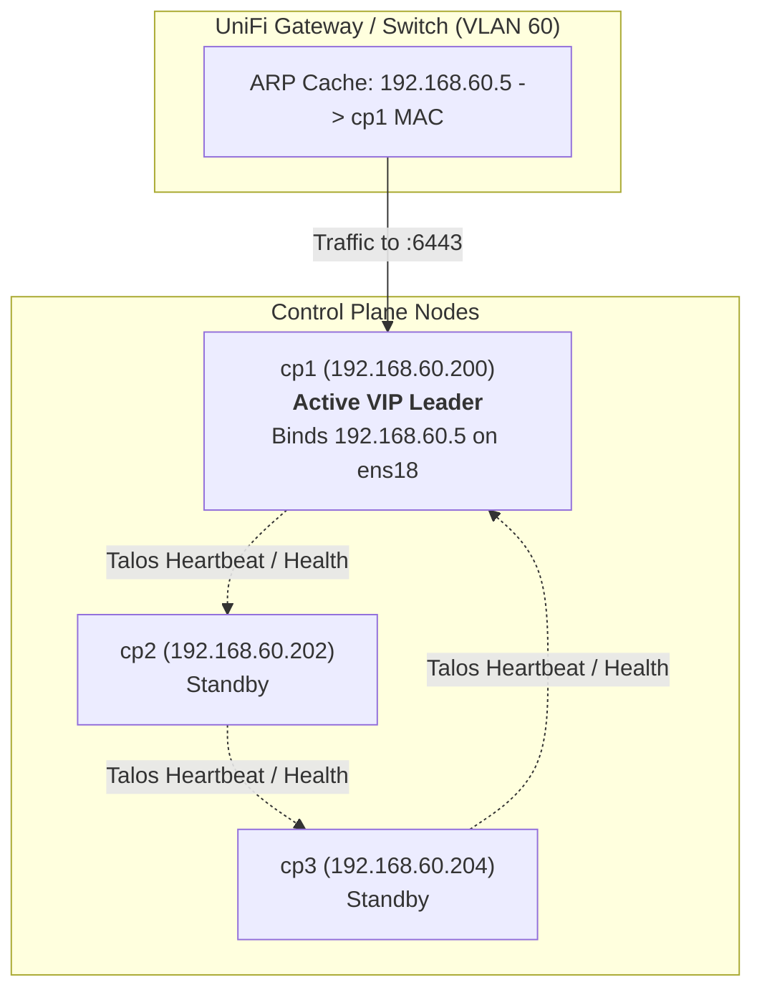

# Talos Linux Kubernetes Cluster on Proxmox VE (`tk-cluster-02`)

This repository contains the Terraform configuration to provision and bootstrap a production-grade, highly available Kubernetes cluster running [Talos Linux](https://www.talos.dev/) across three physical Proxmox VE servers in a homelab environment.

The entire provisioning lifecycle—from creating virtual machines and configuring UEFI/disks in Proxmox to pushing machine configs, bootstrapping `etcd`, and exporting `kubeconfig`—is fully automated.

---

## Architecture Overview

```
                      UniFi Gateway (ucgf) - VLAN 60 (192.168.60.0/24)
                                      │
                         Floating VIP: 192.168.60.5:6443
                                      │
              ┌───────────────────────┼───────────────────────┐
              ▼                       ▼                       ▼
      PowerEdge03 (pe3)       PowerEdge04 (pe4)       PowerEdge05 (pe5)
      ┌───────────────┐       ┌───────────────┐       ┌───────────────┐
      │  cp1 (VM 200) │       │  cp2 (VM 202) │       │  cp3 (VM 204) │  ◄── 3-Node HA Control Plane
      ├───────────────┤       ├───────────────┤       ├───────────────┤
      │   w1 (VM 206) │       │   w2 (VM 208) │       │   w3 (VM 210) │  ◄── Dedicated Workers
      └───────────────┘       └───────────────┘       └───────────────┘
```

* **Physical Infrastructure:** 3x Dell PowerEdge R630 servers joined in a single Proxmox VE cluster (`proxmox-cluster`).
* **Virtual Topology:** 6 Virtual Machines (3 Control Planes + 3 Workers) evenly distributed across the physical servers (1 CP and 1 Worker per physical host).
* **High Availability:** A 3-node `etcd` control plane allows any 1 physical server to fail without losing cluster quorum or causing Kubernetes API downtime.
* **Network & VIP:** Nodes communicate on dedicated VLAN `60` (`192.168.60.0/24`). Talos automatically manages a Layer-2 floating Virtual IP (`192.168.60.5`) across the control plane nodes via Gratuitous ARP, eliminating the need for an external load balancer.

---

## Node Inventory & Allocation

| VM Name | Role | Proxmox Node | VM ID | IP Address | MAC Address | Specs |
| :--- | :--- | :--- | :---: | :--- | :--- | :--- |
| **`cp1`** | Control Plane | `PowerEdge03` | `200` | `192.168.60.200` | `52:54:00:60:02:00` | 2 vCPU, 4 GB RAM, 30 GB Disk |
| **`cp2`** | Control Plane | `PowerEdge04` | `202` | `192.168.60.202` | `52:54:00:60:02:02` | 2 vCPU, 4 GB RAM, 30 GB Disk |
| **`cp3`** | Control Plane | `PowerEdge05` | `204` | `192.168.60.204` | `52:54:00:60:02:04` | 2 vCPU, 4 GB RAM, 30 GB Disk |
| **`w1`**  | Worker | `PowerEdge03` | `206` | `192.168.60.206` | `52:54:00:60:02:06` | 4 vCPU, 20 GB RAM, 60 GB Disk |
| **`w2`**  | Worker | `PowerEdge04` | `208` | `192.168.60.208` | `52:54:00:60:02:08` | 4 vCPU, 20 GB RAM, 60 GB Disk |
| **`w3`**  | Worker | `PowerEdge05` | `210` | `192.168.60.210` | `52:54:00:60:02:10` | 4 vCPU, 20 GB RAM, 60 GB Disk |
| **VIP**  | K8s API Endpoint | *Floating (CP)* | — | `192.168.60.5` | — | Port 6443 |

*Total Physical Server Allocation:* ~24 GB RAM per physical host (out of 32 GB total), leaving ~8 GB for the Proxmox hypervisor.

---

## Prerequisites

Before running Terraform, ensure the following are in place:

### 1. Talos ISO Uploaded to Proxmox
The Talos `metal-amd64.iso` must be present on the `local` storage pool on all three Proxmox hosts (`PowerEdge03`, `PowerEdge04`, `PowerEdge05`):
* Expected volume ID: `local:iso/metal-amd64.iso`

### 2. UniFi DHCP Fixed IP Reservations
When the VMs first boot from the ISO into memory, they obtain an initial IP via DHCP before Talos formats the disk and applies the permanent static configuration.

The 6 MAC-to-IP reservations **must exist** in the UniFi Network application (**Client Devices $\rightarrow$ Add Client**) on network `kube` (VLAN 60) using the MAC addresses and IPs listed in the table above.

### 3. Installed Local Tools
* [Terraform](https://developer.hashicorp.com/terraform/install) $\ge$ `1.5.0`
* [talosctl](https://github.com/siderolabs/talos/releases) matching cluster release (e.g., `v1.14.2`)
* [kubectl](https://kubernetes.io/docs/tasks/tools/)

---

## Configuration (`terraform.tfvars`)

Copy `terraform.tfvars.example` to `terraform.tfvars`:

```bash
cp terraform.tfvars.example terraform.tfvars
```

Edit `terraform.tfvars` with your Proxmox API credentials:

```hcl
proxmox_endpoint  = "https://192.168.1.30:8006/"
proxmox_api_token = "root@pam!terraform=<YOUR_TOKEN_SECRET>"
```

> [!NOTE]
> If you need to generate a new Proxmox API token, SSH into any Proxmox node and run:
> ```bash
> pveum user token add root@pam terraform --privsep 0
> ```

---

## Deployment Steps

### 1. Initialize Terraform
Downloads the required providers (`bpg/proxmox`, `siderolabs/talos`, `hashicorp/local`):
```bash
terraform init
```

### 2. Review the Plan
Inspect the resources to be created (17 resources total: 6 VMs, machine secrets, 6 machine config applies, bootstrap, kubeconfig, and local files):
```bash
terraform plan
```

### 3. Apply the Configuration
Execute the deployment:
```bash
terraform apply
```

---

## How it Works Under the Hood

1. **VM Creation (`proxmox_vms.tf`):**
   * Uses the `bpg/proxmox` provider.
   * Configures UEFI (`OVMF`), `q35` machine type, VirtIO SCSI disk on `local-lvm`, QEMU Guest Agent, and attaches `local:iso/metal-amd64.iso`.
   * Boot order is set to `["scsi0", "ide2"]`. Since `scsi0` is initially blank, UEFI falls through and boots the live Talos ISO from `ide2`.
2. **First Boot & DHCP:**
   * VMs boot the Talos live environment into RAM and request DHCP.
   * UniFi matches the pre-configured MAC addresses and assigns `192.168.60.200`–`210`.
3. **Talos Configuration & Installation (`talos.tf`):**
   * The `siderolabs/talos` provider connects to the live ISO environment over gRPC port `50000`.
   * It pushes the machine config specifying `install.disk = "/dev/sda"`, the static IP network configuration, nameservers, and VIP.
   * The installer image includes the `qemu-guest-agent` extension (`factory.talos.dev/installer/ce4c980550dd2ab1b17bbf2b08801c7eb59418eafe8f279833297925d67c7515:v1.14.2`).
4. **Reboot to Disk:**
   * Talos installs to disk and reboots the VM.
   * On reboot, UEFI finds the EFI bootloader on `scsi0` and boots directly from the installed disk.
5. **Cluster Bootstrap & Credentials:**
   * Terraform runs `talos_machine_bootstrap` on `cp1`, initializing `etcd`.
   * Terraform extracts the admin credentials and saves them to local files:
     * `./kubeconfig`
     * `./talosconfig`

---

## High Availability Virtual IP (`192.168.60.5`)

In this cluster, clients (`kubectl`, `./kc`) and worker nodes do not connect to a specific control plane IP. Instead, all traffic routes through a single, highly available floating Virtual IP (**`192.168.60.5:6443`**).

Talos Linux manages this natively at Layer-2 without requiring external load balancers (such as HAProxy, Keepalived, or F5):

### How It Works: Gratuitous ARP & Leader Election



1. **Shared Configuration:** Each control plane node declares the VIP under its primary network interface (`ens18`) in `talos.tf`:
   ```yaml
   machine:
     network:
       interfaces:
         - interface: ens18
           vip:
             ip: 192.168.60.5
   ```
2. **Leader Election:** Talos control plane nodes maintain an internal heartbeat consensus. One node is elected the active VIP leader (e.g., `cp1`).
3. **Gratuitous ARP (GARP):** The leader adds `192.168.60.5/24` to its `ens18` interface and broadcasts a Gratuitous ARP frame across VLAN 60 (*"192.168.60.5 is at MAC 52:54:00:60:02:00"*). All switches and the UniFi gateway update their ARP tables so packets for `192.168.60.5:6443` route directly to the active node.

### Automatic Failover (Zero-Downtime HA)
* If `cp1` crashes, reboots, or loses power, `cp2` and `cp3` detect the lost heartbeat within ~2–3 seconds.
* A surviving node (e.g., `cp2`) is elected the new leader and immediately binds `192.168.60.5` to its `ens18` NIC.
* It broadcasts a new Gratuitous ARP frame (*"192.168.60.5 is now at MAC 52:54:00:60:02:02"*).
* Network traffic immediately redirects to `cp2` without manual intervention or DNS changes.

> [!IMPORTANT]
> **Why `ens18` matters:** In QEMU/Proxmox with VirtIO NICs, systemd predictable network interface naming designates the primary NIC as `ens18` (PCI bus 0, slot 18), **not** `eth0`. Binding the VIP to `ens18` ensures Talos attaches the daemon directly to the live physical interface.

---

## Ingress & Gateway API (Envoy Gateway)

The cluster is equipped with **Envoy Gateway** (`gateway.envoyproxy.io`) implementing the Kubernetes **Gateway API** (`gateway.networking.k8s.io`):

* **Controller:** Deployed in namespace `envoy-gateway-system` via the official Helm chart (`oci://docker.io/envoyproxy/gateway-helm`).
* **GatewayClass:** `eg` (Accepted and managed by `gateway.envoyproxy.io/gatewayclass-controller`).
* **Service Type:** Configured with `type: ClusterIP` via an `EnvoyProxy` parameter resource (`eg-proxy-config`). This keeps the data plane entirely internal to the cluster network, perfectly tailored for in-cluster Cloudflare Tunnels (`cloudflared`) without requiring open node ports or a bare-metal LoadBalancer.

### Checking Gateway Resources
```bash
# Check Envoy Gateway controller pod
./kc get pods -n envoy-gateway-system

# Verify the GatewayClass is Accepted
./kc get gatewayclass -o wide

# Check installed Gateway API CRDs
./kc get crds | grep gateway
```

---

## Interacting with the Cluster

### Using `kubectl`
You can use the included `./kc` helper script in the repository root, which automatically targets the project's `./kubeconfig`:
```bash
./kc get nodes -o wide
./kc get pods -A
```

Or manually export `KUBECONFIG`:
```bash
export KUBECONFIG=$(pwd)/kubeconfig
kubectl get nodes -o wide
```

### Using `talosctl`
Administer nodes using the generated `talosconfig`:
```bash
export TALOSCONFIG=$(pwd)/talosconfig

# View real-time node dashboard
talosctl -n 192.168.60.200 dashboard

# View dmesg or container logs
talosctl -n 192.168.60.200 dmesg
talosctl -n 192.168.60.200 containers -k
```

---

## Repository Structure

```text
kubernetes-terraform/
├── .gitignore              # Ignores .tfstate, tfvars, kubeconfig, talosconfig, .terraform/
├── .terraform.lock.hcl     # Pinned provider dependency versions & hashes (commit to git)
├── versions.tf             # Provider requirements & Proxmox connection config
├── variables.tf            # Default sizing, IP mappings, MACs, VLAN, and cluster parameters
├── terraform.tfvars.example# Template for Proxmox credentials
├── terraform.tfvars        # Your actual secrets (DO NOT COMMIT)
├── proxmox_vms.tf          # Proxmox VM resource declarations for CPs and Workers
├── talos.tf                # Talos secrets, machine configs, bootstrap, and kubeconfig
├── envoy_gateway.tf        # Envoy Gateway Helm release & GatewayClass deployment
├── cloudflare_tunnel.tf    # Cloudflare Zero Trust tunnel, DNS records, & in-cluster cloudflared
├── outputs.tf              # Outputs node reservations, tunnel CNAME, and writes local credential files
├── charts/                 # Local Helm charts
│   └── envoy-gateway-config# Custom chart defining GatewayClass, ClusterIP EnvoyProxy, Gateway & Service
├── kc                      # Executable helper script wrapping kubectl with local kubeconfig
└── README.md               # This documentation
```

---

## Ingress & Cloudflare Zero Trust Tunnel Architecture

All external traffic enters the cluster via a secure, zero-trust Cloudflare Tunnel (`cloudflared`):

```
                        [ Internet Traffic ]
                                 │
                                 ▼
                     [ Cloudflare Edge Network ]
                    (*.teasdale.dev / CNAME proxy)
                                 │
                   (Encrypted QUIC/HTTP2 Tunnel)
                                 │
                                 ▼
         [ cloudflared DaemonSet (1 replica per worker, HA) ]
                   (Namespace: `cloudflare`)
                                 │
                 (Internal ClusterIP TCP:80)
                                 │
                                 ▼
         [ Envoy Gateway Ingress (ClusterIP Service) ]
               (Namespace: `envoy-gateway-system`)
                                 │
                        (Gateway API HTTPRoute)
                                 │
                                 ▼
             [ Target Application Service & Pods ]
```

### Exposing Services with Gateway API (`HTTPRoute`)

Because the tunnel routes `*.teasdale.dev` to the in-cluster Envoy Gateway, exposing any new service simply requires creating an `HTTPRoute` resource in your application's namespace:

```yaml
apiVersion: gateway.networking.k8s.io/v1
kind: HTTPRoute
metadata:
  name: my-app-route
  namespace: my-namespace
spec:
  parentRefs:
  - name: eg-gateway
    namespace: envoy-gateway-system
  hostnames:
  - "my-app.teasdale.dev"
  rules:
  - backendRefs:
    - name: my-app-service
      port: 80
```

---

## Destroying / Tearing Down

To decommission the entire cluster, remove the Cloudflare tunnel, DNS records, and delete the VMs from Proxmox:

```bash
terraform destroy
```
